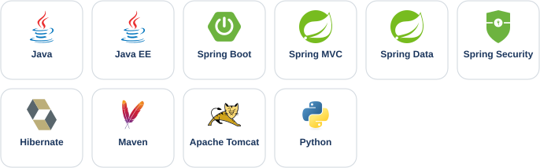

  

📍 Madrid, España · <b>Disponible para prácticas y empleo, incorporación inmediata</b> (presencial, híbrido o remoto)

  
  
  

## 🙋 Sobre mí

Vengo de **más de 9 años en banca y servicios financieros** (CaixaBank, Liberbank, Eurocaja Rural y DCredit), donde gestioné carteras de clientes, expedientes hipotecarios e incidencias operativas con plazos de resolución inferiores a 24 h.

En 2025 di el salto al desarrollo de software. Desde entonces me formo en **backend con Java y Spring** en programas de Accenture y la Universidad San Pablo CEU, y en **Cloud y DevOps** con AWS, Docker, Kubernetes y Terraform.

Mi experiencia en banca me aporta algo que valoran los equipos técnicos: **entiendo el negocio financiero desde dentro**, trabajo con SLA y priorizo por impacto.

## 🛠️ Stack técnico

### Backend

### Bases de datos

### Calidad y testing

### DevOps y herramientas

### En formación · Bootcamp Cloud y DevOps

## 🚀 Proyectos destacados

### 🏨 [Aplicación de Gestión Hotelera](https://github.com/JorgeMPM/ProyectoHotelAppEquipo) · *proyecto en equipo*
Aplicación web para la gestión integral de un hotel: habitaciones, huéspedes, reservas e incidencias.
- **Problema y solución:** la operativa diaria de un hotel requiere que cada perfil acceda solo a lo que le corresponde. La aplicación centraliza la gestión en un único sistema con autenticación y control de acceso por rol (recepcionista y supervisor).
- **Implementación técnica:** arquitectura en capas (controller · service · DAO) con interfaces y configuración de Spring basada en clases Java. Persistencia con Hibernate (`SessionFactory`) y transacciones declarativas con `@Transactional`. Excepciones personalizadas por operación y código documentado con Javadoc.
- **Stack:** Java 11 · Spring MVC 5 · Hibernate 5 · MySQL 8 · JSP · JSTL · Maven · Apache Tomcat · Git

### 📻 [Gestión de Eventos para Emisora de Radio](https://github.com/JorgeMPM/GestionEventosEmisoraRadio_JavaEE)
Aplicación web para consultar los eventos musicales de una emisora de radio.
- **Problema y solución:** el equipo de la emisora necesita localizar eventos de forma rápida y con acceso restringido. La aplicación ofrece inicio y cierre de sesión, listado de eventos y búsqueda por criterio.
- **Implementación técnica:** patrón MVC con Front Controller: un único servlet recibe todas las peticiones y las delega en controladores que implementan una interfaz común. Acceso a datos con JDBC mediante un pool de conexiones (`DataSource`) y consultas parametrizadas con `PreparedStatement`. Gestión centralizada de errores con una excepción propia.
- **Stack:** Java 11 · Java EE (Servlets · JSP · JSTL) · JDBC · MySQL 8 · Apache Tomcat · Git

### 👤 [Sistema de Registro e Inicio de Sesión](https://github.com/JorgeMPM/NuevoRegistro_Java_Spring)
Aplicación web de registro e inicio de sesión de usuarios con Spring MVC.
- **Problema y solución:** capturar y validar los datos de un usuario a través de formularios web. La aplicación implementa el flujo completo de registro, confirmación de datos e inicio de sesión.
- **Implementación técnica:** controlador con `@GetMapping` y `@PostMapping`, enlace automático de los datos del formulario con el objeto `Usuario` mediante `@ModelAttribute`, y resolución de vistas JSP configurada en XML.
- **Stack:** Java 11 · Spring MVC · JSP · JSTL · Bootstrap · Apache Tomcat · Git

### 🎮 [Tres en Raya en Python](https://github.com/JorgeMPM/TicTacToe-TresEnRaya-_Python)
Juego de tres en raya por consola contra la máquina. Proyecto final del curso de certificación PCEP.
- **Problema y solución:** aplicar los fundamentos de Python a un caso completo. El juego gestiona el tablero, los turnos, la validación de movimientos y la detección de victoria o empate.
- **Implementación técnica:** diseño modular basado en funciones. La máquina abre siempre en el centro y después elige casilla al azar entre las libres.
- **Stack:** Python 3 · módulo estándar `random`

> 🔜 Próximamente: proyectos con **Spring Boot**, APIs REST y Docker del programa Java Backend con IA Generativa.

## 🎓 Certificaciones

| Certificación | Emisor | Fecha |
|---|---|---|
| Oracle Cloud Infrastructure 2025 Certified Foundations Associate | Oracle University | Abr. 2026 |
| Critical Career Skills – Generative AI Foundations | Certiport (Pearson VUE) | Feb. 2026 |
| PCEP-30-02 – Certified Entry-Level Python Programmer | Python Institute | Jun. 2025 |

## 📚 Formación técnica

- **Programa de Especialización en Desarrollo Backend Java e IA Generativa** · Accenture y Universidad San Pablo CEU · 2026
- **Bootcamp Cloud Computing y DevOps** · BlockStellart · 2025 – actualidad
- **Programa de Especialización en Desarrollo Backend Java** · Accenture · 2025 – 2026

## 🌍 Idiomas

Español (nativo) · Inglés B1 (experiencia profesional en Reino Unido)

## 📫 Contacto

  

  
  
  

